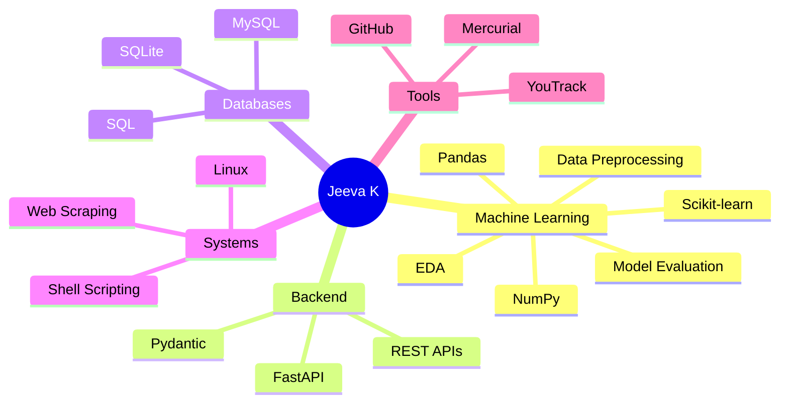
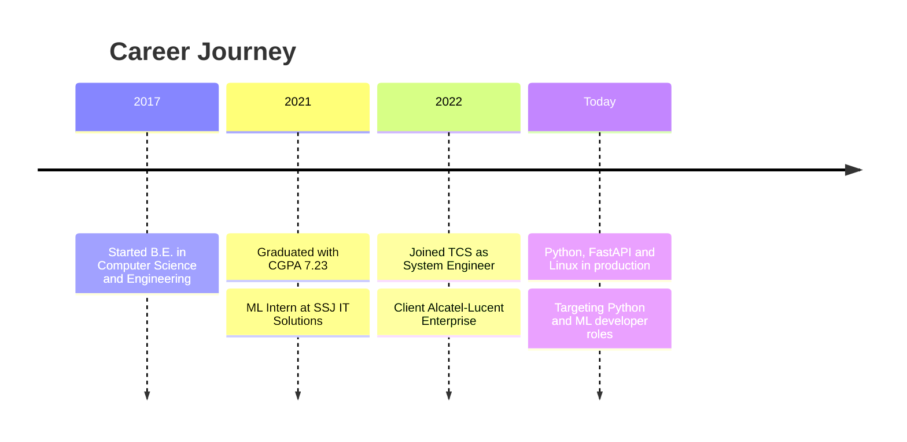

 

  

 

## About

<table>
<tr>
<td width="58%" valign="top">

I am a **System Engineer at Tata Consultancy Services** with 4 years of experience in Python development on Linux. I build REST APIs with FastAPI, train machine learning models with Scikit-learn, and analyse data with Pandas and NumPy.

I enjoy debugging, improving existing software, and turning messy data into something useful. I am looking for a **Python / Machine Learning Developer** role where I can build scalable, data-driven applications.

</td>
<td width="42%" valign="top">

| | |
|:-:|:--|
| 💼 | System Engineer, TCS |
| 🌍 | Client: Alcatel-Lucent Enterprise, France |
| 📍 | Chennai, India |
| 🎓 | B.E. Computer Science and Engineering |
| 🎯 | Python / Machine Learning roles |
| 📧 | [Send me an email](mailto:jeevajiivi3003@gmail.com) |

</td>
</tr>
</table>

 

## Skills

| Area | Technologies (click to open the official site) |
|:--|:--|
| **Language** |   |
| **Machine Learning** |    |
| **Backend** |   |
| **Databases** |   |
| **Systems and Tools** |     |

<a href="#top">⬆ Back to top</a>

## Impact

Left: minimum counts from my TCS work (30+, 20+, 50+, 15+). Right: reported accuracy of my ML projects (Credit Card ~85%, Personal Loan ~82–88%).

<a href="#top">⬆ Back to top</a>

## GitHub Activity

 

 

<a href="#top">⬆ Back to top</a>

## Experience

<b>System Engineer</b> · Tata Consultancy Services (TCS) · Jan 2022 – Present · Chennai, India

 

> `Python` `FastAPI` `Pydantic` `Linux` `SQL` `Mercurial` `YouTrack`

**Client:** Alcatel-Lucent Enterprise, France

- Resolved **30+ production defects**, improving system stability and reducing recurring incidents by **25%**.
- Handled **20+ high-priority production issues** and customer escalations through Change Requests (CR).
- Designed and ran **50+ unit test cases**, improving code reliability and reducing post-release defects.
- Delivered **15+ feature enhancements and bug fixes** with developers, testers, and product teams.
- Built Python-based enterprise PBX applications on Linux, plus **FastAPI REST APIs** with data validation, authentication handling, and database operations for configuration management.
- Wrote Low-Level Design documents and Unit Test Specifications, and took part in code reviews and knowledge transfer sessions.

<b>Machine Learning Intern</b> · SSJ IT Solutions Pvt Ltd · Apr 2021 – Sept 2021

 

> `Python` `Pandas` `NumPy` `Scikit-learn`

- Worked on ML models using Python, Pandas, NumPy, and Scikit-learn.
- Preprocessed data and ran exploratory data analysis on datasets with **5K+ records**.
- Built and evaluated multiple models, improving prediction accuracy through feature engineering and model tuning.

<a href="#top">⬆ Back to top</a>

## Projects

<table>
<tr>
<td width="33%" valign="top">

### 💳 [Credit Card Approval Prediction](https://github.com/jeevakarthikeyan?tab=repositories)

Classification model that predicts customer credit card eligibility from **5K+ records**.

**Models:** Logistic Regression, Decision Tree, Random Forest, KNN

**Result:** ~85% accuracy with Random Forest

</td>
<td width="33%" valign="top">

### 🏦 [Personal Loan Approval Prediction](https://github.com/jeevakarthikeyan?tab=repositories)

Predicts loan approval from customer financial data, using EDA and feature selection to improve performance.

**Models:** Bagging, Random Forest

**Result:** ~82–88% accuracy on validation data

</td>
<td width="33%" valign="top">

### 📞 [PBX Configuration API](https://github.com/jeevakarthikeyan?tab=repositories)

Professional work at TCS (private code). REST APIs to manage PBX configuration and data processing.

**Covers:** validation, authentication handling, database operations

**Result:** 15+ features and fixes shipped

</td>
</tr>
</table>

<a href="#top">⬆ Back to top</a>

## Achievements and Education

| | Recognition | Details |
|:-:|:--|:--|
| ⭐ | **Star of the Month Award** | Tata Consultancy Services |
| 🤝 | **Service and Commitment Award** | Tata Consultancy Services |
| 🎓 | **B.E. Computer Science and Engineering** | K.S. Rangasamy College of Technology (Autonomous), Tiruchengode · 2017 – 2021 · CGPA 7.23 |

 

## Currently Learning

| Topic | Focus | Resource |
|:--|:--|:-:|
| 🚀 **Advanced FastAPI** | Async endpoints, background tasks, auth patterns | [Docs](https://fastapi.tiangolo.com/) |
| 🤖 **ML in Production** | Model packaging, serving models through APIs | [Scikit-learn](https://scikit-learn.org/stable/model_persistence.html) |
| 🧠 **Deep Learning** | Neural network basics, training and evaluation | [Learn](https://www.deeplearning.ai/) |
| 🗄️ **Databases** | Query optimization, schema design | [SQLite](https://www.sqlite.org/docs.html) |

<a href="#top">⬆ Back to top</a>

## Contact

  

Open to Python / Machine Learning Developer roles building scalable data-driven applications.

